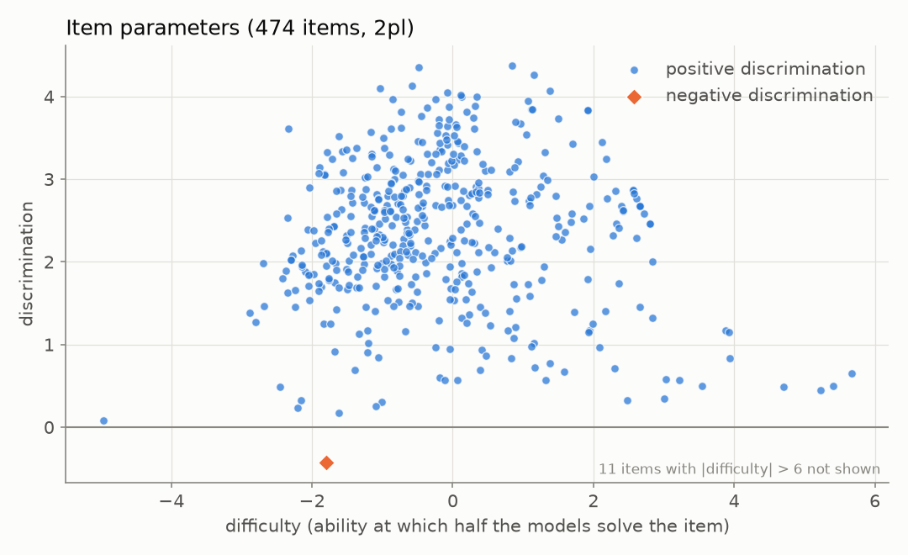
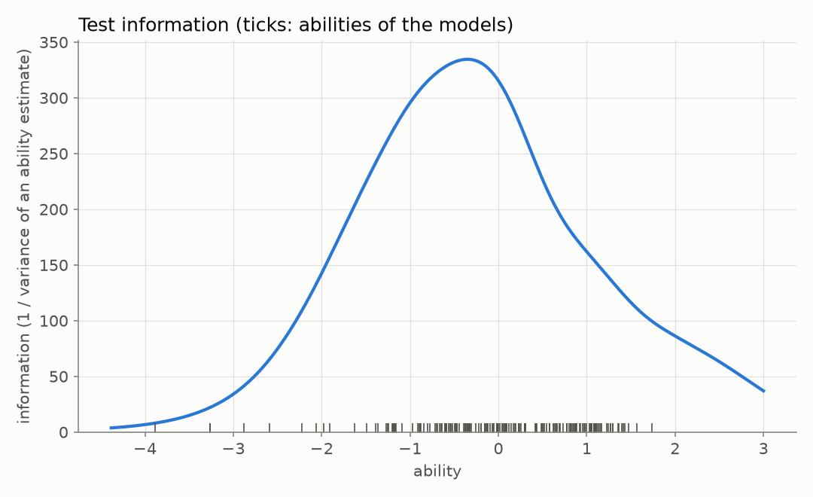
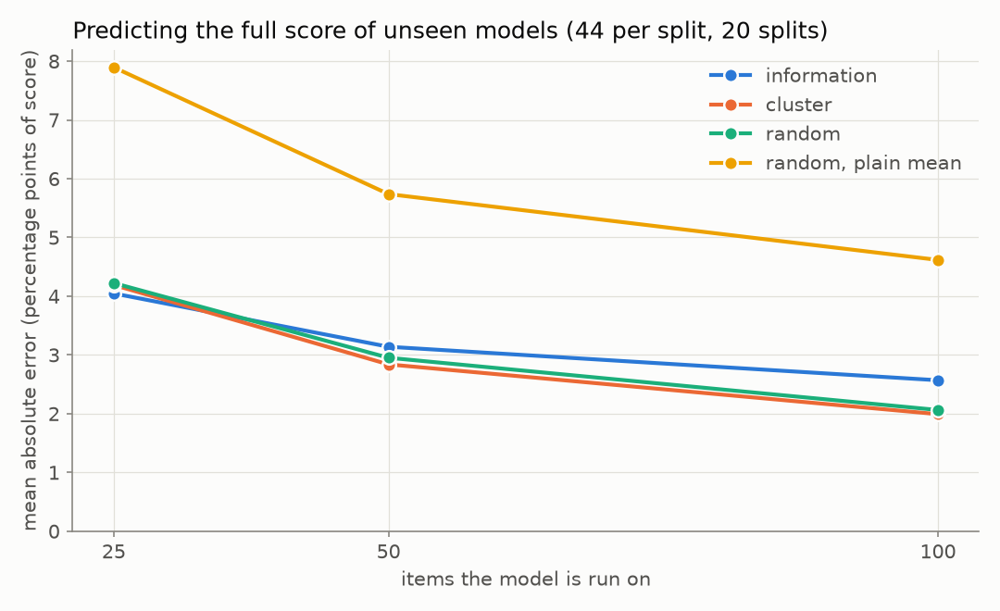

# irtbench

Fit item response models to a models-by-items matrix of benchmark results, to find which items
separate models, which carry no information, and how small a subset of items predicts the full
score.

## Why this is hard

A benchmark score counts every item the same. Some items are solved by every model and some by
none, so they say nothing about which model is better, and a few behave backwards: weaker models
solve them and stronger ones do not, which usually means the item is broken or mislabelled.
Telling these apart needs a model of how the chance of solving an item changes with the strength
of the model, fitted to a matrix that has few rows (models), many columns (items) and gaps. Both
of those shapes break the textbook recipe: with hundreds of items per model a fixed quadrature
grid is too coarse and the fit is wrong without saying so, and with few models the likelihood
of a two-parameter model has no maximum for some items.

## Install

```
pip install git+https://github.com/vipul21435/irtbench
```

Python 3.10 or newer; depends on numpy and scipy. Charts need the extra:
`pip install "irtbench[plot] @ git+https://github.com/vipul21435/irtbench"`.

## Quickstart

The input is either long (one record per cell: `model`, `item`, `score` with score 0 or 1, as
CSV, TSV or JSON lines) or a wide CSV whose first column is the model name and whose other
columns are items. Absent or empty cells are missing. `--model-col`, `--item-col` and
`--score-col` rename the long-format columns.

`examples/toy_results.csv` is simulated data, not a real benchmark: 40 models on 24 items drawn
from a 2PL model with a fixed seed, with 27 cells removed (`python examples/make_toy.py`
regenerates it).

```
$ irtbench fit examples/toy_results.csv --rows 3
# irtbench fit: toy_results.csv

- data: 40 models x 24 items, 27 of 960 cells missing
- model: 2pl by marginal maximum likelihood (EM on a gauss-hermite grid of 61 nodes, slope prior sd 0.5 around a common slope of 1.08)
- log-likelihood: -478.500 with 48 parameters; EM converged in 20 iterations
- items left out of the fit: 0 solved by all, 0 solved by none, 0 without data

## Items (hardest first, 3 of 24)

| item | status | solved | discrimination | difficulty |
|---|---|---:|---:|---:|
| item-19 | estimated | 0.11 | 0.53 | 4.20 |
| item-10 | estimated | 0.03 | 1.23 | 3.50 |
| item-09 | estimated | 0.03 | 1.25 | 3.36 |

## Models (strongest first, 3 of 40)

| model | answered | solved | ability | sd |
|---|---:|---:|---:|---:|
| model-36 | 22 | 0.68 | 1.57 | 0.51 |
| model-32 | 24 | 0.71 | 1.46 | 0.49 |
| model-33 | 23 | 0.70 | 1.44 | 0.49 |
```

`irtbench items` lists what is wrong with the items (add `--se information` or `--se bootstrap`
for standard errors):

```
$ irtbench items examples/toy_results.csv --rows 3
...
- solved by all: 0; solved by none: 0
- negative discrimination: 0; negative correlation with the rest score: 1

## Items that behave backwards (1 of 1)

| item | flags | solved | discrimination | rest correlation | infit | outfit |
|---|---|---:|---:|---:|---:|---:|
| item-19 | negative_rest_correlation | 0.11 | 0.53 | -0.05 | 1.15 | 1.47 |
```

`irtbench subset` chooses items and saves the fit; `irtbench predict` then estimates the full
score of a model from its answers on those items only. Here `answers.csv` holds the answers of
three of the models on the six chosen items; on all items model-02, model-01 and model-03
actually score 0.54, 0.27 and 0.13.

```
$ irtbench subset examples/toy_results.csv -k 6 --json subset.json
item-02
item-21
item-15
item-03
item-05
item-13
$ irtbench predict answers.csv --fit subset.json
# irtbench predict: answers.csv

- fit: 2pl on 24 items; answers given on 6 of them
- predicted score: estimated share of the fitted items the model would solve

## Models (strongest first, 3 of 3)

| model | answered | solved | ability | sd | predicted score |
|---|---:|---:|---:|---:|---:|
| model-02 | 6 | 0.67 | 0.13 | 0.61 | 0.461 |
| model-01 | 6 | 0.33 | -0.78 | 0.57 | 0.289 |
| model-03 | 6 | 0.33 | -0.88 | 0.58 | 0.279 |
```

`irtbench report FILE` prints everything at once (both fits, 1PL against 2PL, held-out cells,
item diagnostics, the subset evaluation) as Markdown, `--json PATH` saves it as JSON and
`--plots DIR` writes charts. Every command takes `--json`. `python examples/quickstart.py` does
the same steps through the Python API.

## How it works

**Model.** A model `i` with ability `theta_i` solves item `j` with probability

```
P(x_ij = 1 | theta_i) = sigmoid(a_j * theta_i + d_j),    theta_i ~ N(0, 1)
```

where `a_j` is the discrimination and `d_j` the intercept; the difficulty `b_j = -d_j / a_j` is
the ability at which the item is solved half the time. In the 1PL all items share one `a`. That
is the Rasch model (Rasch 1960, *Probabilistic Models for Some Intelligence and Attainment
Tests*; see the [Rasch model](https://en.wikipedia.org/wiki/Rasch_model) article), written with
abilities of standard deviation `a` so that the 1PL is the 2PL with equal slopes. The 2PL is
the two-parameter logistic model associated with Allan Birnbaum, whose two chapters are in Lord
and Novick's *Statistical Theories of Mental Test Scores* (1968).

**Marginal maximum likelihood.** The abilities are integrated out and the item parameters
maximise the marginal likelihood by EM, as in Bock and Aitkin (1981,
[doi:10.1007/BF02293801](https://doi.org/10.1007/BF02293801)). The E-step computes each model's
posterior weight on every quadrature node and, per item, the expected numbers of attempts and of
solves at each node; the M-step is a weighted logistic regression per item (with one shared
slope for the 1PL) solved by Newton steps with backtracking. After each M-step the ability
distribution is standardised again: the posterior mean `m` and variance `v` of the abilities
give the rescaling `a <- a * sqrt(v)`, `d <- d + a * m`. Without this step EM needs hundreds of
iterations on long tests, because the answers pin down `a * theta` and only the prior on
abilities moves the scale.

**Quadrature that follows the posteriors.** EM starts on a 61-point Gauss-Hermite rule, whose
nodes are 0.40 apart near zero. A model that answered 500 items has a posterior standard
deviation around 0.06, so that rule puts each model on one or two nodes and the fitted scale is
wrong. irtbench therefore measures the width of every posterior (from the curvature of the
log-posterior at its mode) and, when the node gap exceeds the narrowest width or `1.25 /
max|a_j|`, continues on an equally spaced grid fine enough for both, spanning every posterior
until its log-density has dropped by 32. On simulated results of 100 models on 500 items,
generated with a common slope of 1.5 and abilities scaled to mean 0 and standard deviation 1:

```python
import numpy as np
from irtbench import fit_mml, simulate_responses

rng = np.random.default_rng(5)
ability = rng.standard_normal(100)
ability = (ability - ability.mean()) / ability.std()
data, _ = simulate_responses(
    100, 500, kind="1pl", seed=5, ability=ability, discrimination=np.full(500, 1.5)
)
for resolution in (None, 1.0, 0.5):
    fit = fit_mml(data, "1pl", resolution=resolution)
    print(resolution, fit.quadrature, fit.n_nodes, round(float(fit.discrimination[0]), 3))
```

```
None gauss-hermite 61 1.225
1.0 uniform 145 1.517
0.5 uniform 288 1.517
```

The fixed rule (`resolution=None`) gives a slope of 1.225; the default gives 1.517, and halving
the node gap again does not change it. The fit reports the grid it ended on and how fine it is
relative to the target (`fit.quadrature`, `fit.n_nodes`, `fit.resolution`).

**A prior on the 2PL slopes.** With few models, an item solved by exactly the strongest models
is fitted better and better as its slope grows, so the likelihood has no maximum. On the
40-model example, `irtbench fit examples/toy_results.csv --slope-prior-sd 0 --max-iter 150`
stops unconverged with a largest slope of 3966. The 2PL is therefore fitted with a normal prior
on the ratio of each slope to a common slope `c`,

```
a_j / c ~ N(1, s^2),    log prior = -sum_j (a_j / c - 1)^2 / (2 s^2),    c = sum(a^2) / sum(a)
```

where `c` is not preset: it is the value that maximises the prior for the current slopes. The
prior only sees how much the slopes differ from each other relative to their size. A prior on
the raw slopes would not do: it can be made cheaper by shrinking every slope and spreading the
abilities out to compensate, and the tests check that under the ratio prior the abilities keep
a spread of 1. The default `s = 0.5` puts a slope of zero two prior standard deviations below
the common slope, so a negative slope needs evidence. `s -> 0` gives the 1PL and
`s -> infinity` the maximum-likelihood 2PL. The estimate is the mode of the posterior of the
item parameters, a Bayes modal estimate in the sense of Mislevy (1986,
[doi:10.1007/BF02293979](https://doi.org/10.1007/BF02293979)); it is not a maximum-likelihood
estimate, and the choice of `s` matters (see the results below). With the default, the example
above converges in 20 iterations with slopes between 0.45 and 1.63.

**Abilities.** Each model gets the mean of its posterior (EAP) and the posterior standard
deviation. Missing cells are skipped, which is only right if the reason a cell is missing does
not depend on what its score would have been.

**Item diagnostics.** Items solved by all or by none have no finite intercept; they are
flagged and left out of the fit. For the rest: the point-biserial correlation between the item
and the rest score (the share solved among the model's other items); a
`negative_discrimination` flag when the 2PL slope is below zero and a
`negative_rest_correlation` flag when that correlation is; item information `a^2 P (1 - P)` and
test information (their sum); and the Rasch infit and outfit mean squares, computed from the
1PL at the EAP abilities: outfit is the mean of `(x - P)^2 / (P (1 - P))` over models and infit
is `sum (x - P)^2 / sum P (1 - P)`. Both are expected to be near 1; Linacre's guide
([Rasch Measurement Transactions 16:2, 2002](https://www.rasch.org/rmt/rmt162f.htm)) reads 0.5
to 1.5 as productive and above 2.0 as degrading the measurement.

**1PL against 2PL.** AIC, BIC (with the number of models as the sample size) and the
likelihood-ratio statistic on the difference in parameter counts; and, more usefully,
held-out cells: the observed cells are split into folds, each fold is hidden, the model is
refitted and every hidden cell is predicted from its model's remaining cells (the item curve
averaged over the model's posterior). Mean log-likelihood per cell, AUC and accuracy are
reported next to a baseline that predicts each item's solve rate and ignores the model.

**Subsets.** `information` visits nine abilities spread over the fitted models (their 10 % to
90 % quantiles) in turn and takes the unused item with the most information at each;
`cluster` runs k-means on the items' fitted curves at those abilities and takes the item
nearest each centre; `random` draws items uniformly. The full score of a new model is then
estimated in the spirit of the IRT estimator of tinyBenchmarks (Polo et al. 2024,
[arXiv:2402.14992](https://arxiv.org/abs/2402.14992)): its answers on the subset count as they
are, and every other item counts with the probability the fit gives it. Here that probability
is averaged over the model's ability posterior instead of being evaluated at a point estimate.
The evaluation holds out models, not cells: the IRT model is fitted on the training models
only, items are chosen from that fit only, and the error is measured on models the fit never
saw.

**Joint maximum likelihood** (`fit_jml`) estimates one ability per model together with the item
parameters, with a ridge penalty that keeps perfect and zero scores finite. It is there for
comparison; under the Rasch model with complete data, models with equal raw scores get equal
abilities, which the tests check.

**Standard errors.** `standard_errors` inverts the observed information of the marginal
likelihood (the complete-data information minus the posterior covariance of the complete-data
score, checked in the tests against a numerical Hessian); with the slope prior it adds the
prior's curvature. `bootstrap_standard_errors` refits on models resampled with replacement.

Earlier uses of item response theory on machine learning evaluations that this follows: Lalor,
Wu and Yu (2016, [EMNLP](https://aclanthology.org/D16-1062/)) built an evaluation scale for
textual entailment from human responses; Rodriguez et al. (2021,
[ACL](https://aclanthology.org/2021.acl-long.346/)) modelled a leaderboard with latent skill and
item difficulty to find informative examples and annotation errors; Vivek et al. (2024,
[arXiv:2309.08638](https://arxiv.org/abs/2309.08638)) chose small "anchor point" subsets from
the way models' confidences agree across examples.

## Results on public SWE-bench Verified submissions

Data: the per-submission results in the public repository
[SWE-bench/experiments](https://github.com/SWE-bench/experiments), folder
`evaluation/verified`, at commit `40f164d5b8f1d249bf95a6df8b74b577fd8e519d` (fetched on
2026-11-13). SWE-bench Verified has 500 instances
([swebench.com](https://www.swebench.com/SWE-bench/guides/datasets/)). That repository shows no
licence, so nothing from it is in this repository: the script below downloads the result files
(about 6 MB) to a directory of yours. Of the 182 submission folders, 175 had a results file in
one of the two layouts the script reads; one of those marks all 500 instances as unresolved and
is dropped as an incomplete record, leaving 174 submissions by 500 items with no missing cell.
Their scores run from 0.4 % to 79.2 % (median 56.5 %).

```
python scripts/fetch_swebench_verified.py data
python examples/swebench_verified_study.py data/swebench_verified.csv --json study.json --plots docs
```

The study took 112 seconds here. All numbers below are from that run.

**Items that carry no information.** No instance is solved by every submission. 26 of the 500
are solved by none.

**Discrimination.** The 2PL (slope prior 0.5) was fitted to the other 474 items on a grid of
278 nodes; the median posterior standard deviation of an ability is 0.061.

| | min | 5 % | 25 % | median | 75 % | 95 % | max |
|---|---:|---:|---:|---:|---:|---:|---:|
| discrimination | -0.43 | 0.50 | 1.75 | 2.36 | 2.90 | 3.74 | 4.38 |

The mean is 2.30 and the standard deviation 0.93; 60 items have less than half the median
discrimination. The median standard error of a discrimination (observed information) is 0.42.



(Eleven items with an absolute difficulty above 6 are outside the plotted range, among them
two of the three with a negative discrimination.)

**Items that discriminate negatively.** Three items have a negative slope:

| instance | discrimination | standard error | solved by | rest correlation |
|---|---:|---:|---:|---:|
| `sympy__sympy-18763` | -0.43 | 0.17 | 32.2 % | -0.23 |
| `astropy__astropy-7606` | -0.40 | 0.30 | 4.6 % | -0.17 |
| `django__django-11790` | -0.02 | 0.18 | 21.3 % | -0.06 |

Only the first is more than two standard errors below zero. Seven items have a negative
correlation with the rest score: these three and `django__django-13794`,
`matplotlib__matplotlib-23299`, `matplotlib__matplotlib-23476` and `sphinx-doc__sphinx-10614`.
These are candidates to look at by hand, not findings: nothing here inspected the instances.
The count depends on the prior: with a slope prior of 0.25 one item is negative, with 1.0 seven
are.

**1PL against 2PL.**

| model | parameters | log-likelihood | AIC | BIC |
|---|---:|---:|---:|---:|
| 1PL | 475 | -27348.8 | 55647.5 | 57148.1 |
| 2PL | 948 | -25625.1 | 53146.2 | 56141.0 |

The likelihood-ratio statistic is 3447.3 on 473 degrees of freedom. Held-out cells (5 folds,
87,000 cells):

| predictor | log-likelihood per cell | AUC | accuracy |
|---|---:|---:|---:|
| item solve rate only | -0.4598 | 0.8553 | 0.775 |
| 1PL | -0.3171 | 0.9380 | 0.863 |
| 2PL | -0.3036 | 0.9433 | 0.867 |

The 2PL predicts hidden cells better than the 1PL, by a smaller margin than the in-sample
criteria suggest. Under the 1PL, 38 items have an infit above 1.3 and 64 an outfit above 2.0.
Joint and marginal 1PL fits agree: their abilities correlate at 0.99995 and their intercepts at
0.9998.



**Predicting the score of unseen submissions from a few items.** 20 random splits into 130
submissions to fit on and 44 to predict; mean absolute error of the predicted full score, in
percentage points, with the standard deviation over splits in brackets. For `random` the error
is averaged over 10 subsets per split.

| items | information | cluster | random | random, plain mean |
|---:|---:|---:|---:|---:|
| 25 | 4.05 (0.42) | 4.19 (0.46) | 4.22 (0.21) | 7.89 (0.99) |
| 50 | 3.14 (0.47) | 2.84 (0.39) | 2.95 (0.12) | 5.74 (0.70) |
| 100 | 2.57 (0.43) | 1.99 (0.27) | 2.06 (0.09) | 4.62 (0.65) |



What this shows: on a random subset, the IRT estimator has about half the error of the plain
mean of the answers (4.2 against 7.9 points at 25 items). Choosing the items did not help
beyond that. Clustering is within noise of random subsets at every size, and the
information-based choice is about the same at 25 items and worse at 100. So for this
benchmark the gain comes from the estimator, not from the selection, and 25 items leave an
error of about 4 points.

## Limitations

- One ability per model, binary scores, no guessing parameter. Partial credit, several
  abilities and three-parameter models are not implemented.
- Submissions are treated as independent draws from one population. On a leaderboard they are
  not: many share a base model or a scaffold, and they improve over time. The standard errors,
  AIC, BIC and the likelihood-ratio statistic are therefore optimistic, and the chi-square
  reference for the latter assumes many models and a fixed number of items, the opposite of a
  benchmark. Read them as descriptions; the held-out results are the ones to rely on.
- The held-out evaluations split submissions and cells at random. They do not test prediction
  for future systems that are stronger than everything the model was fitted on.
- The 2PL estimates depend on the slope prior. Its form and its default of 0.5 are choices,
  and the number of items flagged as negative moved from one to seven across priors of 0.25 to
  1.0 on the real data. Without the prior the 2PL does not converge on small matrices.
- A flag is a reason to read an item, not evidence that it is broken. No flagged instance was
  inspected.
- The quadrature criterion is a rule of thumb for peaked, smooth posteriors. In the tests it
  keeps the error of a model's log-likelihood below 1e-7 from 3 to 2000 items, and the fit
  reports when the node limit (`max_nodes`, default 2001) stops it from being met.
- Infit and outfit use EAP abilities, which are shrunk towards zero, so on short tests they
  fall somewhat below 1 even when the Rasch model holds. Standardised fit statistics are not
  computed.
- The observed-information standard errors hold the common slope of the prior fixed, and the
  bootstrap resamples models only; neither reflects uncertainty about which items are in the
  benchmark.
- The comparison against an independent implementation is a direct maximisation of the same
  marginal likelihood with scipy's optimiser and quadrature, written in the tests. No
  third-party IRT package was installed and compared.
- Missing cells are assumed missing at random. The largest matrix fitted so far is 175 by 500;
  larger ones were not timed.
- The fetch script depends on the layout of the upstream repository at the commit above, and
  drops one submission whose file marks nothing as resolved; `--keep-empty` keeps it.

## Related tools

- [evalstats](https://github.com/vipul21435/evalstats): error bars and paired comparisons for
  evaluation scores. irtbench does not compute intervals or tests on scores.
- [prefpairs](https://github.com/vipul21435/prefpairs): Bradley-Terry models for pairwise
  preference data, the pairwise relative of the Rasch model.
- [py-irt](https://github.com/nd-ball/py-irt): Bayesian IRT models in Python fitted by
  variational inference on Pyro; the tinyBenchmarks paper cites it for its fits.
- [mirt](https://cran.r-project.org/package=mirt): multidimensional item response theory in R,
  with EM over quadrature and stochastic estimation; far more models than this package.

## Development

```
uv run --extra dev ruff check .
uv run --extra dev pytest -q --cov=irtbench
```

## Licence

MIT. Copyright (c) 2026 Vipul Raj Jha.

Built by Vipul Raj Jha · https://vipul21435.github.io
